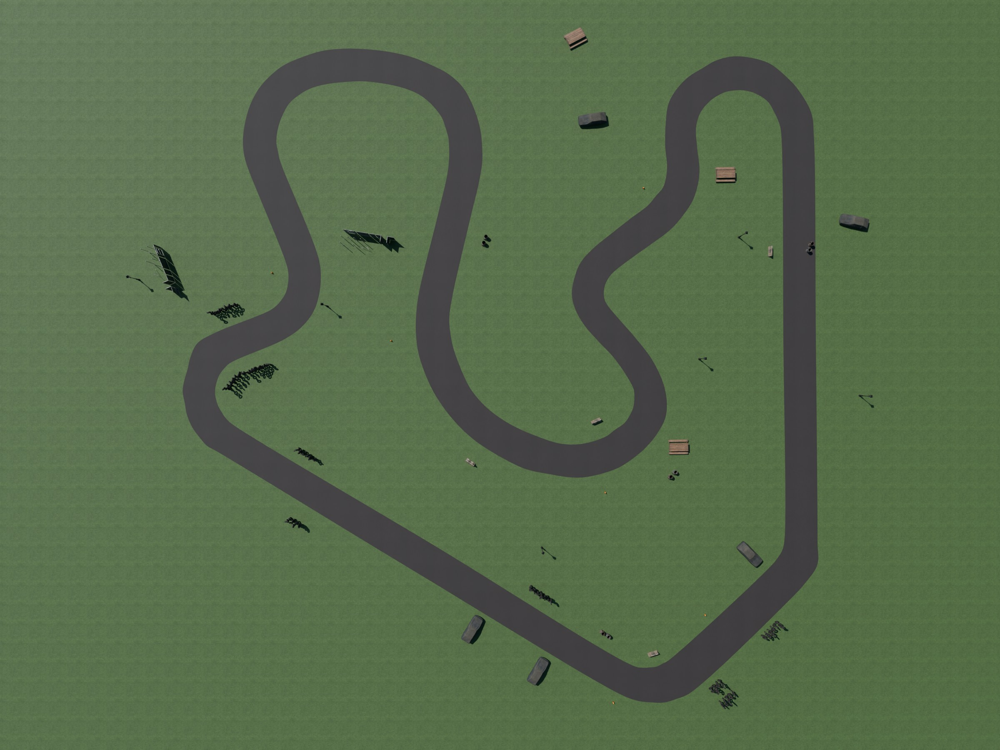
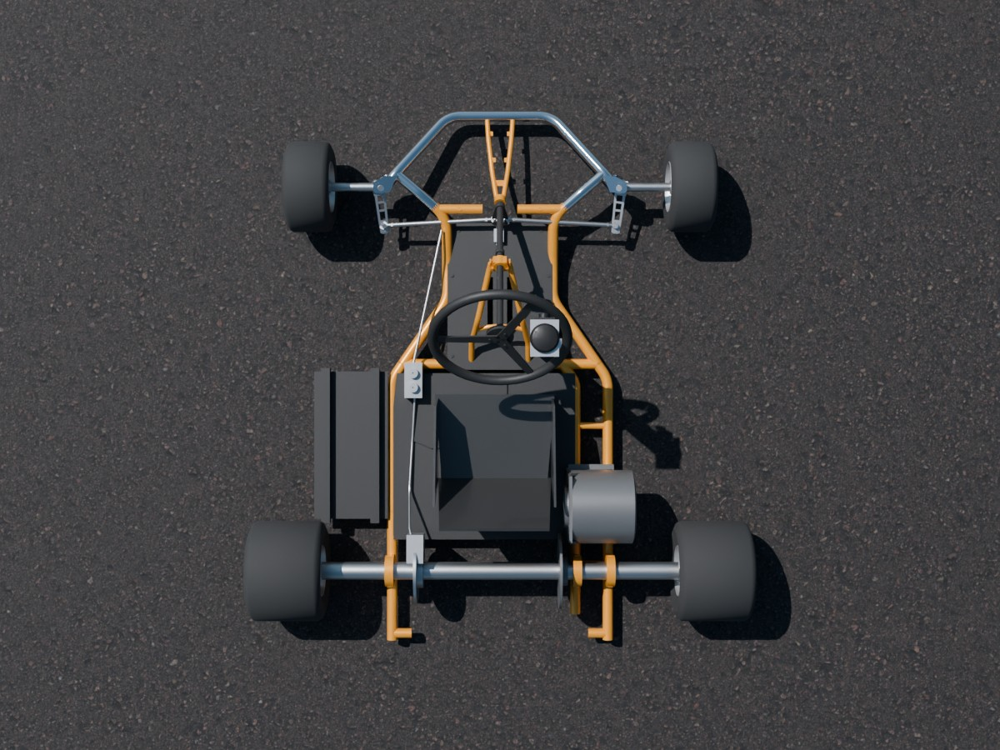

# AutonomousSimulator
A27+ Multi-Config Sim

End-to-end simulator for the Purdue EVC autonomous kart. It runs the real ROS 2 stack (`autonomous_kart` from AutonomousKart) against Project Chrono kart models in lockstep with a simulated `/clock`, and scores whether the stack still drives across kart designs, sensor noise and conditions.

## Setup

- Docker, and a clone of AutonomousKart next to this repo (or set `AUTONOMOUS_KART_REPO`)
- Host Python: `python -m venv .venv && .venv/bin/pip install -r requirements.txt`
- Images, built once and again after any change under `harness/`, `simnode/`, `configs/` or `tracks/`:

```
docker build -f docker/Dockerfile.base -t evc-sim-base:1 docker   # ROS 2 Humble + PyChrono 10, slow
docker build -f docker/Dockerfile -t evc-sim:dev .
```

A job won't run when `evc-sim:dev` was built from a different checkout than the current one.

## Running the simulator

Web UI with a local Docker runner (jobs page, episode viewer, compare, leaderboard):

```
.venv/bin/python -m web.app          # http://127.0.0.1:5050, WEB_PORT to change
```

Submit from the jobs page: pick a recipe or a stack branch, a tier and where to run (`local`, `modal`, `ideas`, `gautschi`). The same from Python, without the UI:

```
.venv/bin/python -c "
from harness import config; from runner import jobs, local
jobs.submit('smoke', config.load('recipes', 'stack-default'), 'me', 'first smoke')
local.Runner().run_once(where='local')"
```

Tiers live in `configs/tiers/` (`smoke` is the quick check, `dev` feeds the leaderboard), recipes in `configs/recipes/`, conditions in `configs/conditions/`. Each recipe's stack is built once into a Docker volume keyed by its commit, and every episode is cached by its inputs, so a rerun only runs what changed. Results go to `results/` (`AUTONOMOUS_SIM_RESULTS`).

In the `overtake` and `endurance_overtake` tiers the stack is told nothing about the opponent unless the camera is on (recipe `"sim": {"use_camera": true}`, or the kart's `use_camera` mount). With it on, the sim publishes `/opponents` in the stack's wire format, as `kart_detector_node` would, from a camera-like model in the kart's `sensors.opponents` (field of view, range limit, range bias and noise, bearing noise, missed detections, latency, frame rate, coasting). Conditions can override that model like any other sensor. No frames are rendered: running the real detector on rendered frames in the loop does not exist yet.

Tests: `.venv/bin/python -m pytest -q`; the container checks are `tests/container/*.sh`.

## Camera ranging tests

How well the stack localizes an opponent kart from its forward camera. These cases are not on the leaderboard. Each case renders photorealistic scenes in Blender Cycles: both karts are built from the Twister CAD parts, lit by Poly Haven HDRIs (raceways, parking lots, overcast and low sun) with tyre walls, barriers, cones and cars around them. The renders go through a camera signal model (exposure, motion blur, shot and read noise, MJPEG, camera_node's resize to 360 px) into the stack's own `kart_detector_node`, running unmodified under ROS 2. The node's `/opponents` positions are compared with the true positions.

The rendered Purdue track from above, with the still obstacles around it, and the kart built from the CAD parts:





| Case | What varies |
|---|---|
| `static_range` | opponent dead ahead at 3-40 m, six environments |
| `static_bearing` | lateral position across the field of view at 6, 12, 20 m |
| `static_heading` | opponent yaw from rear view to head-on |
| `static_variants` | opponent designs: tower, bare frame, bodywork, tall mast, large |
| `static_lighting`, `static_exposure` | sun ahead, side and behind; under- and over-exposure |
| `static_clutter`, `static_far`, `static_occlusion` | heavy background clutter; karts at 30-60 m; target partly hidden |
| `static_empty` | no kart, false positives only |
| `static_calibration` | camera pitch and height off the configured calibration |
| `track_follow_purdue`, `track_follow_generic`, `track_overtake` | both karts moving, tracker in the loop, on the Purdue track and on a generated track |

Setup, once:

```
uv venv -p 3.11 ~/.cache/evc-sim/render-venv && VIRTUAL_ENV=~/.cache/evc-sim/render-venv uv pip install bpy numpy
```

`EVC_BPY_PYTHON` points at another Python with `bpy` if needed. Assets (about 1.3 GB, CC0) download on first use into `data/perception/assets/`. The run builds `evc-perception:dev` (`evc-sim:dev` plus `cv_bridge` and ONNX Runtime) and the recipe's stack by itself.

Run:

```
.venv/bin/python -m perception.run --recipe kart-detection                    # every case
.venv/bin/python -m perception.run --recipe kart-detection --cases static_range --limit 3
.venv/bin/python -m perception.run --render-only                              # fill the render cache
```

Renders are cached in `data/perception/renders/` by scene, independent of the recipe, so after the first run a new recipe or detector only reruns the stack (minutes). A full first render of all cases is about 1100 frames at 3-20 s each on an M-series GPU.

Detector model: the recipe's `model` names the ONNX file. `kart-detection` expects the team's trained model at `data/perception/models/kart_192x320.onnx`. Until it is there, `kart-detection-standin` uses a yolo11n trained by `perception/train_standin.py` on renders that share no background or pose with the cases; trained on renders only, it measures the harness, not real-world detection. Retrain it with `python -m perception.train_standin` from a Python that has `ultralytics` (about 20 min of renders plus 10 min of training on an M-series Mac).

Output in `results/perception/<run id>/`:
- `summary.json`: per case, detection rate, median and p90 range error, bias, false positives per frame, breakdowns by range bin and by each case parameter, frames to first track
- `fig_range.png` (stack range against true range, detection rate against range), `fig_cases.png`, `fig_track.png`, `fig_calibration.png`
- `eval.jsonl` (one row per true kart per frame), `out.jsonl` (raw `/opponents`), `node_*.log`

Every frame is also ranged by the stack's own `range_boxes` on the true boxes (the `oracle_*` fields). That is the error left with a perfect detector, which separates ranging error from detection error.

Configs are in `perception/configs/` (cases, environments, kart designs, camera, noise levels, recipes), outside `configs/` so they do not change the episode engine hash. The camera's resolution and 1.5 deg pitch come from real frames; its 70 deg horizontal field of view is an estimate until the lens is calibrated.

## Deploy
A push to `main` builds and pushes `docker/Dockerfile.web`.